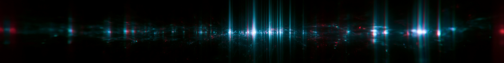

# AETHER CURRENTS



**▸ [LIVE: full experience](https://aether-currents.sinaida.eu/)**

Conduct sound with your hands. A browser-based instrument: on-device hand tracking drives granular audio synthesis and a live visual layer. It is a static site with no build step and no framework, written in vanilla JS/CSS with ES modules.

Concept and experience design by Sinaida Krivchenko, a new media artist based in Prague: the interaction, the system specification and testing with players. Built with agentic tools under her direction. Kamil Yegelev (TeleFM, Belgrade) is the music advisor; his hands-on feedback shaped the instrument's sound and gesture language.

## Artists

- Sinaida Krivchenko, new media artist in Prague: concept and experience design · [sinaida.eu](https://sinaida.eu)
- Kamil Yegelev (TeleFM), Belgrade: music advisor · [telefm.bandcamp.com](https://telefm.bandcamp.com/)

## Quality tiers

AETHER CURRENTS checks what the device can do on load (`syscheck.js`) and applies the best-fitting tier; a tier you pick yourself stays in place:

```
FULL ....... full-resolution field sim, tracking capped at 60Hz
BALANCED ... 192-particle sim, tracking capped at 45Hz / 640px
LIGHT ...... minimal sim, tracking capped at 30Hz
```

A perf watchdog steps down one tier at a time (never straight to LIGHT) if frame time degrades, aiming to keep hand-following latency low on the current device.

## Scriabin color mapping

Each of the 12 chromatic notes played tints the visual field with its color after Alexander Scriabin's note-to-color correspondences, rather than an arbitrary palette:

```
C  ...... red        F  ...... deep red
C# ...... violet      F# ...... bright azure
D  ...... yellow      G  ...... orange
D# ...... steel glint G# ...... purple-violet
E  ...... pearly moonlit A  ... green
                       A# ...... rosy steel
                       B  ...... pearly blue
```

The active note's color is derived from root + scale position each frame and smoothed over ~100ms so octave and band changes glide rather than flash; spectral centroid and level modulate brightness/saturation around that hue.

## Gestures

```
RIGHT HAND x/y ............ playhead position / pitch
RIGHT PINCH ............... grain size
LEFT HAND HEIGHT .......... grain density
TWO-HAND DISTANCE ......... filter + space
FIST ...................... freeze the cloud
FAST OPEN PALM ............ burst
RIGHT 3 FINGERS ........... chord (root + fifth)
LEFT 3 FINGERS (hold) ..... toggle chord / arpeggio
LEFT INDEX POINT UP/DOWN .. octave shift
[ / ] · shift-click BEAT .. BPM down/up · type an exact BPM
MEDIUM .................... stir the field: currents play a second voice
```

## Play modes

The start screen offers two ways to play. FLOW is the open instrument: your hands conduct the currents freely. GRID turns the instrument into a small tape recorder for bars of 16 steps.

Each mode has a short tutorial with live feedback from the camera (FLOW: six steps, GRID: five). On a first visit the start button runs it; once finished, the page remembers it and the tutorial moves to the `TUTORIAL.EXE` box.

In GRID the beat runs and every bar you play is kept on a tape at the bottom of the screen, with a bar counter. Each step keeps a note from the current scale plus the grain size, density and filter your hands held at that moment. The tape plays through a second voice, so your hands keep playing live on top.

```
LEFT PINCH (hold) .... write: the step under the playhead takes the right hand's pose
LEFT FIST (hold) ..... erase the steps the playhead passes
RIGHT FIST ........... freeze the live cloud
SPACE or TAP TAPE .... pause and edit
CTRL/CMD Z ........... undo the last erase run or edit (SHIFT redoes)
```

Chords, the octave shift and the `[ / ]` BPM keys work in GRID as in FLOW.

In EDIT the tape stops and opens as a note editor. Scroll to any bar with a mouse, trackpad, touch or the arrow keys, then add, move or delete notes. Drag the red playhead to scrub, or hold a note to make it stutter. Keyboard: Tab into the notes, move with the arrows, press Enter to add. Mark a range of bars as a loop, play again from any bar, or export the bars as a `.mid` file for a DAW, with or without the beat. The tape is saved in this browser; the next GRID start offers to restore it.

## MIDI out

Gesture and beat events stream live as MIDI CC/notes to a Web MIDI output port. Open it with `▸ MIDI` in the control row or the `M` key. Designed to work as a live controller for a DAW, TouchDesigner or hardware. See [docs/midi.md](docs/midi.md) for the full CC table and DAW setup.

Live out and the GRID `.mid` export are separate: live out streams while you play and needs a MIDI port; the export writes the tape to a file and needs none.

## Running locally

```
python3 -m http.server 8123
```

Open `http://localhost:8123`. No build, no dependencies to install.

## Structure

```
index.html               app shell
css/main.css             all styles
js/main.js               boot module: consent, system check, mode select, camera
js/syscheck.js           capability probe (FULL, BALANCED or LIGHT)
js/tutorial.js           FLOW and GRID tutorials with live gesture feedback
js/grid/sequencer.js     GRID transport: the tape on the beat clock, PLAY and EDIT
js/grid/tape.js          the tape: bars of 16 steps, loop, undo, save format
js/grid/editor.js        EDIT view: note editor, minimap, loop, export window
js/visuals/tape-view.js  the tape at the bottom of the screen in PLAY
js/visuals/crt-overlay.js old-TV glass over the boot and start screens
js/midi/tape-export.js   tape to Standard MIDI File
legal/                   privacy, terms, license
```

## Privacy

Built without cookies, analytics or a server of its own. Camera frames are processed on your device, and the page loads nothing from other servers. See [legal/privacy.html](legal/privacy.html).

## Support & handoff

- Status: active (maintained by Sinaida Krivchenko)
- Run locally: `python3 -m http.server 8123`, then open http://localhost:8123 (no build step)
- Offline: the hand-tracking library and model ship in js/vendor/mediapipe, so a local copy runs without internet
- Performance tiers: auto-detected on load as FULL, BALANCED or LIGHT, with a manual override; a perf watchdog steps down one tier at a time when frame time degrades
- Requirements: a webcam for on-device hand tracking; MIDI out needs a Chromium-based browser (see docs/midi.md)
- Handing over: docs live in docs/ (midi.md, sound-research.md, case-study.md, artist-statement.md); licence terms are in LICENSE, LICENSE-CONTENT and NOTICE
- Rider for live and installation formats: [legal/rider.html](legal/rider.html)
- Contact: https://sinaida.eu/collaborate

## How this was made

Sinaida comes up with the idea, the concept and the way to make it into a system. The making uses whatever the piece needs, from drawing by hand to AI-native production. She cares about integrity and a smooth experience, so every work adjusts to its environment, and each project ships with a rider, a contingency plan and her support.

## License

Code: AGPL 3.0, see [LICENSE](LICENSE) and [NOTICE](NOTICE). Free to use, study, modify and share. Run a modified version, including as a hosted service, and you publish your source under the same terms. Recordings you make with the tool: CC BY 4.0 with mandatory attribution (`AETHER CURRENTS — concept and experience design by Sinaida Krivchenko · music advisor: Kamil Yegelev (TeleFM) — sinaida.eu`, linking [telefm.bandcamp.com](https://telefm.bandcamp.com/) where possible), see [LICENSE-CONTENT](LICENSE-CONTENT) and [legal/license.html](legal/license.html). Third-party code is listed in [THIRD-PARTY.md](THIRD-PARTY.md).

concept and experience design by Sinaida Krivchenko · [sinaida.eu](https://sinaida.eu)  
music advisor: Kamil Yegelev (TeleFM) · [telefm.bandcamp.com](https://telefm.bandcamp.com/)

This repo is a production mirror.

I develop in a private repo and publish releases here. Issues and ideas are welcome: I read them and carry them over. Pull requests stay open as suggestions; I carry good changes over by hand and then close the PR.

<!-- Je suis le spectre d'une rose que tu portais hier au bal. Théophile Gautier, 1837 -->
